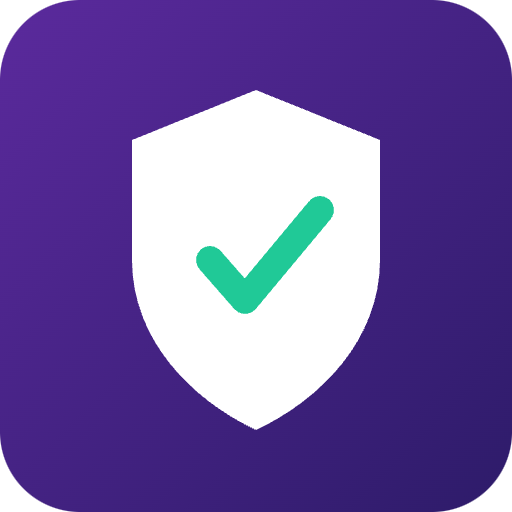

# QuizProof


Learn web3, prove it on-chain with soulbound knowledge NFTs.

## Overview
QuizProof is a web3 trivia app for beginners covering blockchain history, technology, and current topics. As users answer correctly, they level up and earn soulbound NFTs that certify their knowledge tier, creating a verifiable on-chain learning record.

## Problem
Beginners find web3 concepts intimidating, and there is no easy way for them to track or prove their learning progress as they study.

## Solution
QuizProof turns learning into bite-sized quizzes. Correct answers reward users with XP and level progression. When a user reaches a new knowledge tier, QuizProof mints a soulbound NFT that stands as permanent, verifiable proof of their knowledge.

## Features (MVP)
- Topic-based quiz categories: history, tech, DeFi, NFTs, security
- XP and leveling system with difficulty scaling
- Soulbound NFT minted per knowledge tier: Bronze, Silver, Gold, Diamond
- Daily quiz streak tracker with bonus rewards
- Public profile page showing earned NFTs and quiz stats

## Tech Stack
- Next.js (frontend and app logic)
- Solana Web3.js
- Anchor (on-chain program)
- Metaplex Core (soulbound NFTs)
- Supabase (quiz content, progress, streaks)
- Phantom Wallet Adapter

## How It Works

```
User -> Next.js App -> Supabase (quiz content, XP, streaks)
                      -> Anchor Program (level-up check)
                         -> Metaplex Core (mint soulbound NFT)
                            -> User Wallet (Phantom)
                               -> Public Profile Page (on-chain proof displayed)
```

1. User selects a topic and answers quiz questions.
2. Correct answers earn XP, tracked in Supabase for fast gameplay.
3. On reaching a new tier, the Anchor program triggers minting.
4. Metaplex Core mints a non-transferable soulbound NFT to the user's wallet.
5. The public profile page displays earned NFTs and quiz stats for anyone to verify.

## Roadmap
- Expand question bank via community submissions
- Add multiplayer live quiz battles
- Partner with Solana projects to sponsor topic-specific NFT badges

## Pitch
See our one-minute pitch script at [docs/pitch-script.md](docs/pitch-script.md) and the full presentation deck at [docs/pitch.pdf](docs/pitch.pdf).

## Team
- [Name] - Role (e.g. Frontend / Next.js)
- [Name] - Role (e.g. Solana Program / Anchor)
- [Name] - Role (e.g. Design / Product)

_Built for the Colosseum hackathon._

---

🎬 Pitch video: [docs/pitch-video.mp4](docs/pitch-video.mp4)
